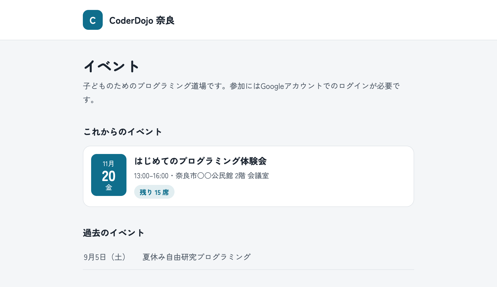
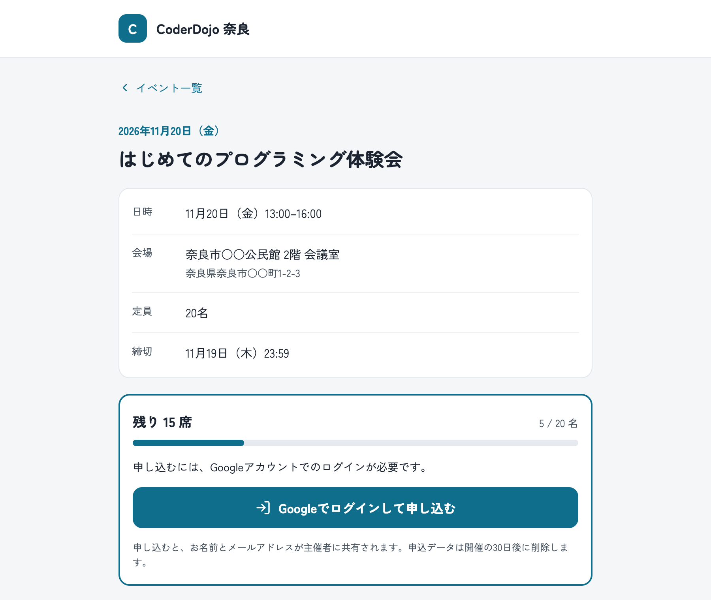
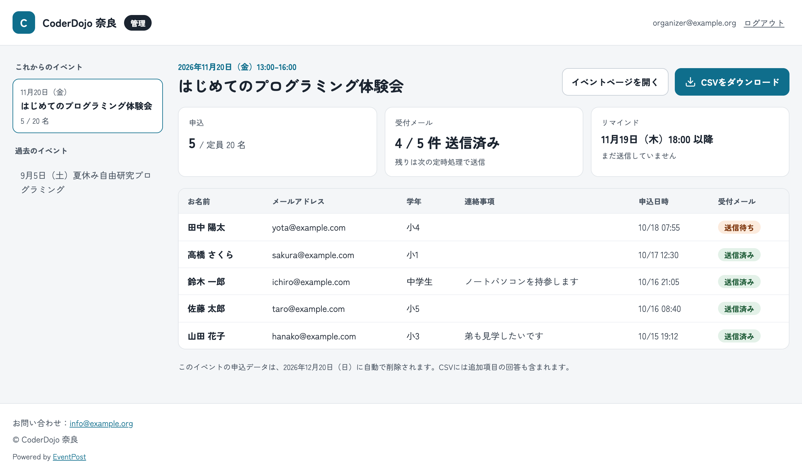

# EventPost

小さなグループ（地域団体、CoderDojo など）のためのイベント管理サイトのテンプレートです。サーバーを用意しなくても、GitHub と Firebase の無料枠だけで次のことができます。

- イベントのページを Markdown で書いて公開する
- Google アカウントでログインした人から申込を受け付ける（定員・締切・追加の入力項目も設定できます）
- 申込受付メールと、開催前日のリマインドメールを自動で送る
- 管理ページで申込者を確認し、CSV でダウンロードする
- 開催から一定日数が過ぎた申込データを自動で削除する

| イベント一覧 | イベント詳細と申込 | 管理ページ |
|---|---|---|
|  |  |  |

## 目次

- [しくみ](#しくみ)
- [はじめる前に](#はじめる前に)
- [セットアップ](#セットアップ)
- [イベントを追加する](#イベントを追加する)
- [メールの文面を変える](#メールの文面を変える)
- [管理ページ](#管理ページ)
- [運用するときの注意](#運用するときの注意)
- [よくあるトラブル](#よくあるトラブル)
- [本体を更新する](#本体を更新する)
- [開発者向け](#開発者向け)

## しくみ

```
  イベントの Markdown を push
            │
            ▼
  GitHub Actions（Deploy）──── Firestore にイベントの情報を写す
            │
            ▼
  GitHub Pages（サイト）◀──── 参加者が Google でログインして申込
            │                        │
            │                        ▼
            │                 Cloud Firestore（申込データ）
            │                        ▲
  GitHub Actions（Notify）─────────┘ 毎時、申込を見て Gmail からメールを送る
```

- **サイト**は GitHub Pages で公開します。`main` に push するたびに作り直されます。
- **ログインと申込データ**は Firebase（Authentication と Cloud Firestore）を使います。無料の Spark プランで足ります。
- **メール**は GitHub Actions が毎時 1 回送ります。そのため、受付メールは申込から最大 1 時間ほど遅れて届きます。

できないこと：キャンセル待ち・抽選、決済、申込内容の編集（キャンセルして申し込み直してもらいます）、HTML メール、1 つのリポジトリで複数のグループを運用すること。

## はじめる前に

次のものを用意してください。

- GitHub のアカウント
- Google アカウント（Firebase とメール送信に使います。グループ用のアカウントを作ると、個人のアカウントと分けられて便利です）

GitHub の画面でファイルを編集してコミットできれば、セットアップできます。手元のパソコンにツールを入れる必要はありません。

## セットアップ

全体で 30 分〜1 時間ほどかかります。順番に進めてください。

### 1. テンプレートからリポジトリを作る

1. [kwaka1208/event-post](https://github.com/kwaka1208/event-post) を開き、右上の **Use this template** → **Create a new repository** を選びます。
2. リポジトリ名（例：`events`）を入れ、**Public** を選んで作成します。

> [!NOTE]
> 「Fork」ではなく「Use this template」を使ってください。フォークしたリポジトリでは、Actions が最初は動きません。
>
> 無料のプランで GitHub Pages を使うには、リポジトリを Public にする必要があります。申込者の個人情報はリポジトリには入らず、Firebase にだけ保存されます。

サイトの URL は `https://ユーザー名.github.io/リポジトリ名/` になります。

### 2. Firebase のプロジェクトを作る

1. [Firebase コンソール](https://console.firebase.google.com/)で **プロジェクトを作成** します。Google アナリティクスは不要です。
2. **Authentication** を開いて **始める** を押し、**ログイン方法** タブで **Google** を有効にします。
3. **Firestore Database** を開いて **データベースの作成** を押します。
   - ロケーションは **asia-northeast1（東京）** などを選びます。あとから変えられません。
   - モードは **本番環境モード** を選びます。ルールは Deploy のときに自動で設定されます。

> [!IMPORTANT]
> データベースは、必ずこの手順で先に作ってください。作らないまま Deploy が動くと、データベースが米国（`nam5`）に作られてしまいます。

4. プロジェクトの概要の横の歯車 → **プロジェクトの設定** → **全般** の下にある **マイアプリ** で、ウェブアプリ（`</>` のアイコン）を追加します。Firebase Hosting の設定は不要です。
5. 表示された `firebaseConfig` の `apiKey`・`authDomain`・`projectId`・`appId` の 4 つを控えておきます（手順 8 で使います）。これらは公開してよい値です。

### 3. ログインを許可するドメインを登録する

**Authentication** → **設定** → **承認済みドメイン** に、`ユーザー名.github.io` を追加します。独自ドメインを使う場合は、そのドメインも追加します。

これを忘れると、ログインのポップアップがすぐに閉じてしまいます。

### 4. サービスアカウントを作る

GitHub Actions が Firestore を読み書きするための鍵を作ります。

1. [Google Cloud コンソールの IAM → サービスアカウント](https://console.cloud.google.com/iam-admin/serviceaccounts)を開き、上部で手順 2 のプロジェクトを選びます。
2. **サービスアカウントを作成** を押し、名前（例：`event-post-actions`）を入れます。
3. 次の 4 つのロールを付けて作成します。

| ロール | 用途 |
|---|---|
| Firebase ルール管理者（`roles/firebaserules.admin`） | セキュリティルールのデプロイ |
| Cloud Datastore インデックス管理者（`roles/datastore.indexAdmin`） | インデックスのデプロイ |
| Cloud Datastore ユーザー（`roles/datastore.user`） | イベントの同期、メール送信の記録、データの削除 |
| Service Usage ユーザー（`roles/serviceusage.serviceUsageConsumer`） | Firestore の API が有効か確かめる |

4. 作成したサービスアカウントを開き、**鍵** タブ → **鍵を追加** → **新しい鍵を作成** → **JSON** を選びます。JSON ファイルがダウンロードされます。

> [!WARNING]
> この JSON ファイルは、Firestore のすべてのデータを読み書きできる鍵です。リポジトリにコミットしたり、人に送ったりしないでください。手順 6 で GitHub に登録したら、パソコンから削除してかまいません。

> [!NOTE]
> 上の 4 つのロールは、firebase-tools のソースと公式ドキュメントから調べた最小限の組み合わせです。Deploy が権限のエラー（`PERMISSION_DENIED` や `does not have ... permission`）で止まった場合は、エラーに出ている権限名（例：`firebaserules.releases.create`）を含むロールを追加してください。

### 5. Gmail のアプリパスワードを作る

メールは Gmail から送ります。送信に使う Google アカウントで、次の 2 つを行います。

1. [2 段階認証プロセス](https://myaccount.google.com/signinoptions/twosv)を有効にします。
2. [アプリパスワード](https://myaccount.google.com/apppasswords)を開き、名前（例：`EventPost`）を入れて作成します。表示された 16 文字のパスワードを控えます。

### 6. GitHub に Secrets を登録する

リポジトリの **Settings** → **Secrets and variables** → **Actions** → **New repository secret** で、次の 3 つを登録します。

| 名前 | 中身 |
|---|---|
| `FIREBASE_SERVICE_ACCOUNT` | 手順 4 の JSON ファイルの中身を、そのまますべて貼り付けます |
| `SMTP_USER` | 送信に使う Gmail アドレス |
| `SMTP_PASSWORD` | 手順 5 のアプリパスワード（空白は除いてもそのままでもかまいません） |

### 7. GitHub Pages を有効にする

**Settings** → **Pages** で、**Source** を **GitHub Actions** にします。

### 8. グループの設定を書く

リポジトリの `site/config.yml` を GitHub の画面で開き、鉛筆のアイコンで編集します。

```yaml
group:
  name: CoderDojo 奈良                 # グループ名（サイトの見出しとメールに出ます）
  description: 子どものためのプログラミング道場です。
  contact_email: info@example.org      # 問い合わせ先（サイトに表示し、メールの返信先になります）

theme:
  accent: "#0F6E8C"                    # アクセントカラー
  # logo: assets/logo.png              # ロゴ画像（任意）

admins:                                # 管理ページを見られる Google アカウント
  - organizer@example.org

firebase:                              # 手順 2 で控えた 4 つの値
  apiKey: "AIza..."
  authDomain: "your-project.firebaseapp.com"
  projectId: "your-project"
  appId: "1:1234567890:web:abcdef"

mail:
  from_name: CoderDojo 奈良            # メールの差出人の表示名
  reminder_hour: 18                    # 開催前日の何時（日本時間）以降にリマインドを送るか

retention_days: 30                     # 開催日から何日後に申込データを削除するか
```

主な項目：

| 項目 | 説明 |
|---|---|
| `theme.accent` | ボタンなどの色。白い文字が読める濃さが必要です（明るすぎるとエラーになります） |
| `theme.logo` | 画像を `site/assets/` に置き、`assets/logo.png` のように書きます。省略するとグループ名の頭文字を表示します |
| `site.base` | 通常は空のままで構いません（自動で設定されます） |
| `site.custom_domain` | 独自ドメインを使うときだけ書きます（例：`events.example.org`） |
| `admins` | 管理ページを見られる人の Google アカウント。大文字・小文字は区別しません |
| `mail.confirmation` | `false` にすると受付メールを送りません（リマインドは送ります） |
| `mail.smtp_host` / `mail.smtp_port` | Gmail 以外から送るときに変えます。既定は `smtp.gmail.com` / `465` |

編集したら **Commit changes** を押します。`main` への push で Deploy が始まります。**Actions** タブで進み具合を見られます。緑のチェックが付いたら、サイトの URL を開いてみてください。

設定に誤りがあると、Deploy の「config.yml とイベントを検証」のステップが失敗し、どこが悪いかがログに表示されます。

### 9. 動作を確かめる

テンプレートには、サンプルのイベントが 2 件入っています（`site/events/`）。

- `2026-11-20-hajimete.md`：これから開催するイベント（定員と追加項目あり）
- `2026-09-05-jiyukenkyu.md`：終了したイベント（一覧の「過去のイベント」に出ます）

1. サイトで「はじめてのプログラミング体験会」を開き、Google でログインして申し込みます。開催日が過ぎている場合は、ファイルの `date` と `deadline` を先の日付に書き換えてから試してください。
2. `admins` に書いたアカウントで `/admin/` を開き、申込が表示されることを確かめます。
3. **Actions** → **Notify** → **Run workflow** を開きます。**dry_run** にチェックが入ったまま実行すると、メールは送らずに「誰に何を送る予定か」とメールの文面の見本をログに表示します。
4. 問題がなければ、次の毎時の実行（毎時 17 分ごろ）で受付メールが届きます。すぐに確かめたいときは、dry_run のチェックを外して Run workflow を実行します。

確かめ終わったら、サンプルのイベントを消すか書き換えて、自分たちのイベントを追加してください。

## イベントを追加する

`site/events/` に Markdown ファイルを追加して push すると、イベントのページができます。GitHub の画面なら **Add file** → **Create new file** で作れます。

ファイル名がイベントの ID（URL の一部）になります。英数字とハイフンだけを使い、`2026-12-05-xmas.md` のように日付から始めると並べやすくなります。**公開した後にファイル名を変えると、別のイベントとして扱われ、それまでの申込とのつながりが切れます。**

```markdown
---
title: はじめてのプログラミング体験会
date: 2026-11-20
start: "13:00"
end: "16:00"
venue: 奈良市○○公民館 2階 会議室
address: 奈良県奈良市○○町1-2-3
capacity: 20
deadline: 2026-11-19T23:59
published: true
fields:
  - id: grade
    label: 学年
    type: select
    options: [小1, 小2, 小3, 小4, 小5, 小6, 中学生]
    required: true
  - id: note
    label: 連絡事項
    type: textarea
reminder_note: |
  ノートパソコンをお持ちの方はご持参ください。
---

## どんなイベント？

ここから下は、イベントページに表示する本文です（Markdown で書けます）。
```

| 項目 | 必須 | 説明 |
|---|---|---|
| `title` | ○ | イベント名 |
| `date` | ○ | 開催日（例：`2026-11-20`） |
| `start` / `end` | ○ | 開始・終了時刻。`"13:00"` のように引用符で囲みます |
| `venue` | ○ | 会場名 |
| `address` | | 住所。ページとメールに表示します |
| `capacity` | | 定員。省略すると無制限です |
| `deadline` | | 申込の締切（例：`2026-11-19T23:59`）。省略すると開始時刻まで受け付けます |
| `published` | | `false` にするとページを出さず、申込も受け付けません。既定は `true` |
| `fields` | | 名前とメールアドレスのほかに聞きたい項目（20 件まで。下の表） |
| `reminder_note` | | リマインドメールに追加する文 |

日時はすべて日本時間です。`fields` の各項目：

| 項目 | 説明 |
|---|---|
| `id` | 項目の識別子。英数字とアンダースコア（例：`grade`）。公開後は変えないでください |
| `label` | 申込フォームと CSV に出す名前 |
| `type` | `text`（1 行）、`textarea`（複数行）、`number`（数値）、`select`（選択肢） |
| `options` | `select` の選択肢（例：`[小1, 小2, 小3]`） |
| `required` | `true` にすると入力必須。既定は `false` |

申込者の名前とメールアドレスは、Google アカウントのものを使います。回答は 1 項目 1000 文字までです。

**イベントを取りやめるとき**は、ファイルを消すか `published: false` にします。

- `published: false`：ページと申込を止めます。すでに申し込んだ人には、リマインドなどのメールが届きます
- ファイルを消す：ページを消し、メールも送りません。申込データは、開催日から `retention_days` 日後に削除されます

中止を申込者に知らせるメールは自動では送られません。管理ページの CSV などで連絡してください。

## メールの文面を変える

受付メールは `site/templates/confirmation.md`、リマインドは `site/templates/reminder.md` です。先頭の `subject:` が件名、`---` より下が本文（プレーンテキスト）です。

本文には、次の値を差し込めます。

| 書き方 | 差し込まれる値 |
|---|---|
| `{{name}}` | 申込者の名前 |
| `{{event.title}}` | イベント名 |
| `{{event.date}}` | 開催日（例：2026年11月20日（金）） |
| `{{event.start}}` / `{{event.end}}` | 開始・終了時刻 |
| `{{event.venue}}` / `{{event.address}}` | 会場名・住所 |
| `{{event.url}}` | イベントページの URL |
| `{{reminder_note}}` | イベントの `reminder_note` |
| `{{group.name}}` / `{{group.contact_email}}` | グループ名・問い合わせ先 |

書き間違えた値があると、Notify がエラーで止まります。文面を変えたら、Notify を dry_run で実行して、ログの見本で確かめてください。

メールの送られ方：

- **受付メール**：申込の後、次の毎時の実行で送ります
- **リマインド**：開催前日の `reminder_hour` 時（日本時間）以降の最初の実行で送ります。前日のその時刻より後に申し込んだ人には、受付メールとリマインドが同時に届きます。開催当日に申し込んだ人には送りません
- イベントが始まった後は、どちらのメールも送りません

## 管理ページ

`サイトの URL/admin/` を開き、`admins` に書いた Google アカウントでログインします。

- 公開中のイベントごとに、申込者の一覧とメールの送信状況を見られます
- **CSVをダウンロード** で、申込者の一覧を Excel で開ける形式（UTF-8・BOM 付き）で保存できます。列は、名前・メールアドレス・追加項目・申込日時・受付メールとリマインドの送信日時です

管理者を追加・削除するときは `site/config.yml` の `admins` を書き換えて push します。

## 運用するときの注意

### 個人情報

- 申込データ（名前・メールアドレス・回答）は Firestore にだけ保存されます。リポジトリにも、Actions のログにも出ません
- 開催日から `retention_days` 日後（既定は 30 日）に、毎時の Notify が自動で削除します。申込件数だけは残ります
- サイトに、申込データの扱い（利用目的・保存期間・問い合わせ先）を書いておくことをおすすめします
- CSV をダウンロードした場合、そのファイルの管理はダウンロードした人の責任になります

### 無料枠の目安

| サービス | 上限の目安 | 注意 |
|---|---|---|
| Gmail | 1 日 500 通程度（Google Workspace は 2,000 通程度） | 1 回の申込で受付とリマインドの 2 通を送ります。上限を超えると、その日は送れなくなります |
| Firestore（Spark プラン） | 読み取り 1 日 5 万回、書き込み 1 日 2 万回、保存 1 GiB | 小さなグループの利用で超えることはまずありません |
| GitHub Actions | 公開リポジトリは無料 | Notify は毎時 1 回、1 分程度で終わります |

上限は変わることがあります。正確な値は各サービスの案内を確かめてください。

### Notify が止まらないようにする（60 日ルール）

公開リポジトリでは、60 日間コミットがないと、定期実行のワークフロー（Notify）が GitHub によって自動で止められます。止まると、メールの送信もデータの削除も行われなくなります。

Notify は毎回、自分自身を有効にし直す処理をしていますが、これで止められずに済むかは確かめられていません。GitHub から「ワークフローが無効になります」というメールが届いたら、空のコミットを push してください。

```bash
git commit --allow-empty -m "Keep workflows active"
git push
```

GitHub の画面だけで済ませたい場合は、README などに 1 行足してコミットしても同じです。すでに止まってしまった場合は、**Actions** → **Notify** → **Enable workflow** で再開できます。

### メールの送信に失敗したとき

1 回の実行で 3 回続けて送信に失敗すると、その回の送信を打ち切ります。失敗が 1 件でもあれば Notify は失敗の扱いになり、GitHub から通知が届きます。送れなかったメールは、次の回に改めて送ります。

## よくあるトラブル

| 症状 | 原因と対処 |
|---|---|
| ログインのポップアップがすぐ閉じる | 承認済みドメインに `ユーザー名.github.io`（または独自ドメイン）がありません（セットアップの手順 3） |
| ログインのボタンを押しても何も起きない | ブラウザがポップアップをブロックしています。アドレスバーの表示からポップアップを許可してください |
| Deploy の「検証」で失敗する | `config.yml` かイベントの書き方に誤りがあります。ログにファイル名と項目が表示されます |
| Deploy の「デプロイ」や「同期」で権限エラー | サービスアカウントのロールが足りないか、`FIREBASE_SERVICE_ACCOUNT` の貼り付けが不完全です（手順 4・6） |
| Deploy は成功したのにサイトが 404 | Settings → Pages の Source が「GitHub Actions」になっていません（手順 7） |
| 申し込もうとすると「申し込めませんでした」 | 通信が切れた、またはイベントを追加した直後で Deploy がまだ終わっていない、などです。Deploy が終わってから再読み込みしてください |
| 管理ページで「権限がありません」 | ログインしたアカウントが `admins` にありません。追加した後に push したかも確かめてください |
| メールが届かない | `SMTP_USER` と `SMTP_PASSWORD` を確かめてください。アプリパスワードは、Google アカウントのパスワードを変えると無効になります。Notify のログに失敗の理由が出ます |
| メールが迷惑メールに入る | 受け取った人に、送信元のアドレスを連絡先に登録してもらってください |
| 受付メールが遅い | 毎時 1 回の送信なので、最大 1 時間ほどかかります。GitHub が混んでいると、さらに遅れることがあります |

## 本体を更新する

`site/` 以外（本体）を新しい版に差し替える手順は [UPDATING.md](UPDATING.md) を見てください。

## 開発者向け

Node.js 22.12 以上が必要です。

```bash
npm install
npm run dev        # 開発サーバー（Auth・Firestore はエミュレーターにつなぐ）
npm run build      # サイトをビルド（app/dist）
npm run check      # 型チェック
npm test           # 単体テスト
npm run validate   # config.yml とイベントの検証だけ行う
```

ルールと同期・Notify のテストは Firestore エミュレーターを使うため、Java 21 以上が必要です。

```bash
npm run test:rules
```

画面をエミュレーターで動かすには、端末を 3 つ使います。

```bash
npm run emulators                                    # 1. Auth と Firestore のエミュレーター
FIRESTORE_EMULATOR_HOST=127.0.0.1:8080 npm run sync  # 2. イベントをエミュレーターに同期
npm run dev                                          # 3. 開発サーバー
```

`npm run test:rules` はエミュレーターのデータを消すので、その後に画面を確かめるときは同期し直してください。

Notify を手元で試すときは、`PAGES_BASE_URL`（例：`https://example.github.io/events/`）が必要です。

```bash
FIRESTORE_EMULATOR_HOST=127.0.0.1:8080 PAGES_BASE_URL=https://example.github.io/events/ npm run notify -- --dry-run
```

ディレクトリの構成：

| パス | 中身 |
|---|---|
| `site/` | グループが編集するもの（設定・イベント・メール文面・画像） |
| `app/` | サイト本体（Astro） |
| `scripts/` | Actions から動かすスクリプト（Firestore への同期、メール送信） |
| `firebase/` | Firestore のセキュリティルールとエミュレーターの設定 |
| `tests/` | ルール・同期・Notify のテスト（エミュレーター） |
| `.github/workflows/` | Deploy・Notify・CI |
