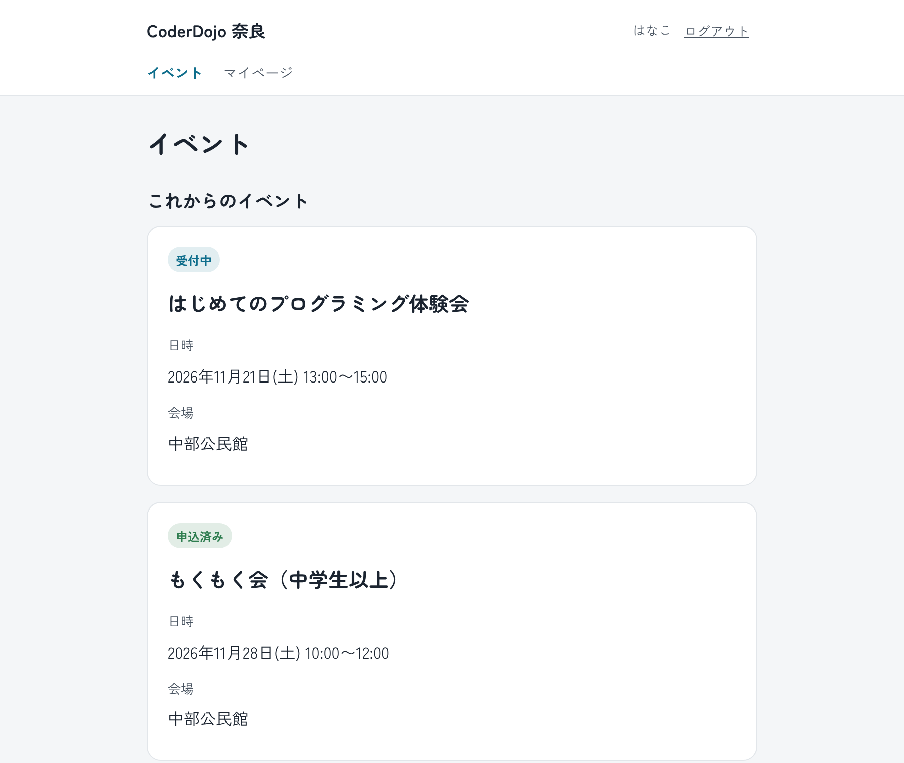
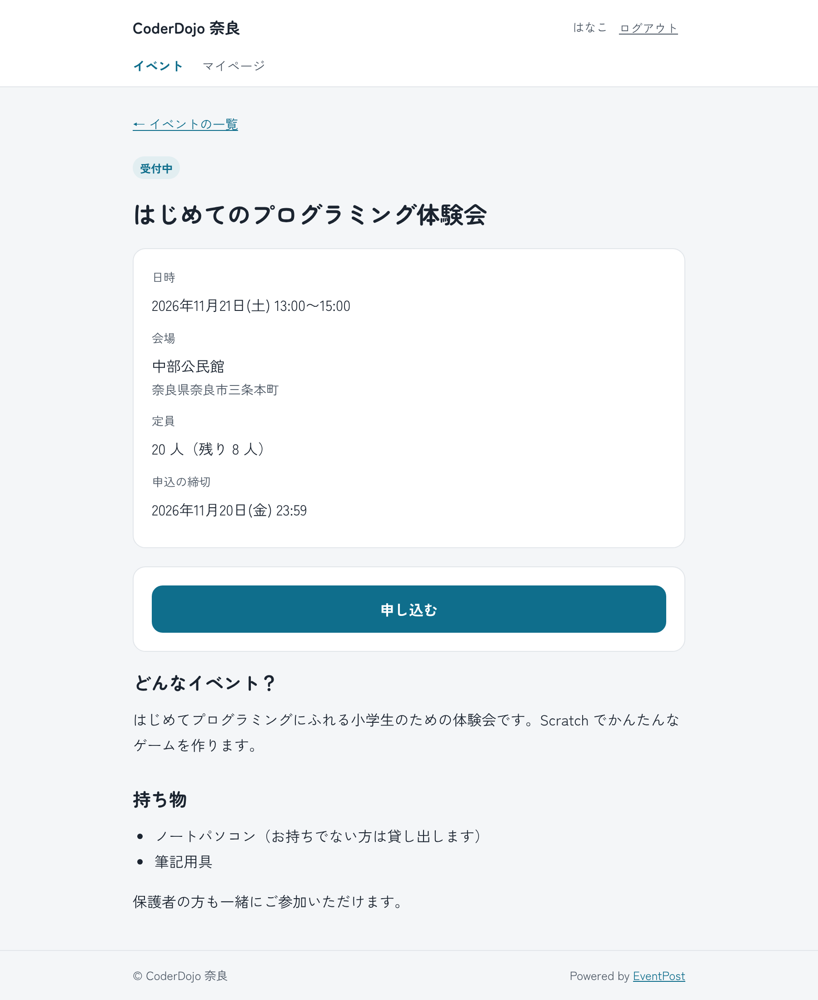
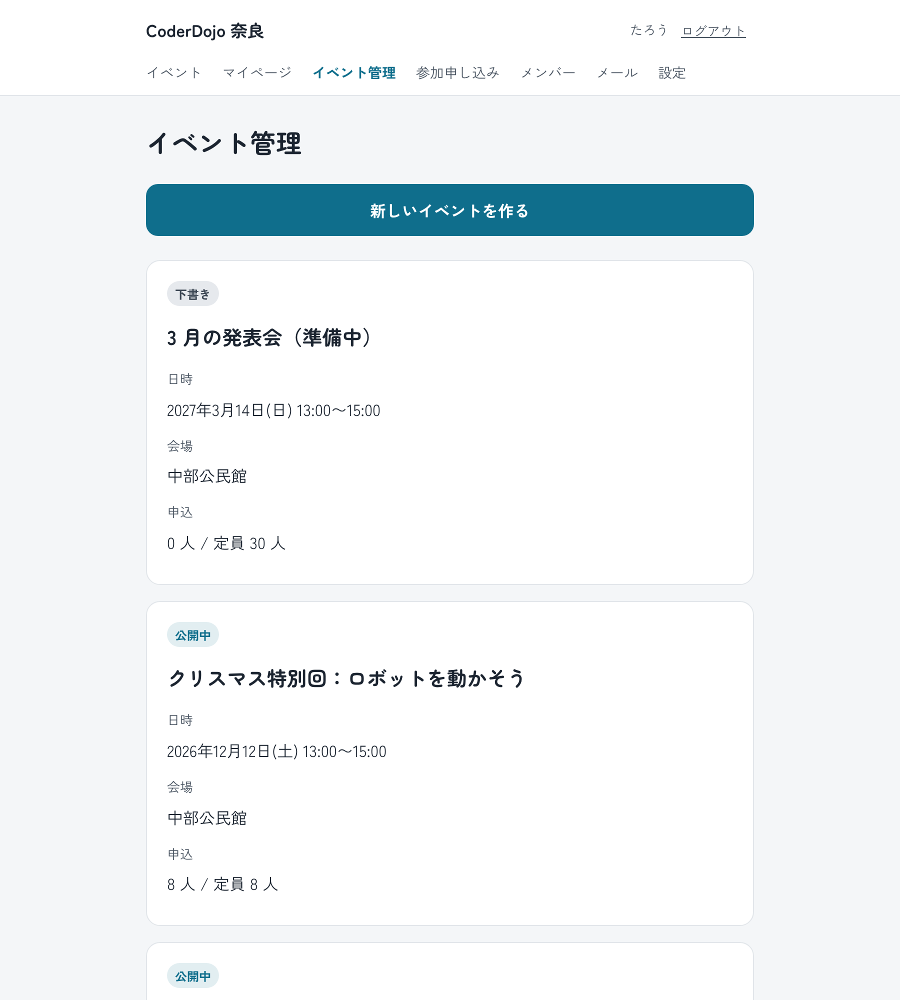

# EventPost

小さなグループ（地域団体、CoderDojo など）のための、クローズドなイベント管理サイトのテンプレートです。サーバーを用意しなくても、GitHub と Firebase の無料枠だけで次のことができます。

- 参加の申し込みを受け付け、管理者が承認した人だけをメンバーにする
- メンバーだけが見られるイベントのページを、画面から作って公開する（定員・締切・下書きも設定できます）
- メンバーが Google アカウントでログインして、イベントに申し込む・キャンセルする
- 申込の受付メールと、開催前日のリマインドを自動で送る
- 管理者が画面からメンバー全員や申込者にメールを送る

トップページ（グループ名と説明）のほかは、承認されたメンバーだけが見られます。

| イベント一覧 | イベント詳細と申込 | イベントの管理 |
|---|---|---|
|  |  |  |

## 目次

- [しくみ](#しくみ)
- [役割](#役割)
- [はじめる前に](#はじめる前に)
- [セットアップ](#セットアップ)
- [使い方](#使い方)
- [メール](#メール)
- [設定（Variables）](#設定variables)
- [運用するときの注意](#運用するときの注意)
- [よくあるトラブル](#よくあるトラブル)
- [本体を更新する](#本体を更新する)
- [旧版（v1）から移る](#旧版v1から移る)
- [開発者向け](#開発者向け)

## しくみ

```
  main に push
       │
       ▼
  GitHub Actions（Deploy）──── Firestore にルールとインデックスを反映
       │
       ▼
  GitHub Pages（画面）◀──── メンバーが Google でログインして使う
                                    │
                                    ▼
                             Cloud Firestore（グループ、メンバー、イベント、申込、メール）
                                    ▲
  GitHub Actions（Notify）────────┘ 毎時、Firestore を見て Gmail からメールを送る
```

- **画面**は GitHub Pages で公開します。`main` に push するたびに作り直されます
- **ログインとデータ**は Firebase（Authentication と Cloud Firestore）を使います。無料の Spark プランで足ります。誰が何を読み書きできるかは、Firestore のセキュリティルールで決めています
- **メール**は GitHub Actions が毎時 1 回送ります。そのため、メールは最大 1 時間ほど遅れて届きます
- 1 つのサイトで 1 つのグループを扱います。グループごとに、このテンプレートからリポジトリを作り、Firebase のプロジェクトを用意します

できないこと：キャンセル待ち・抽選、決済、イベントごとの申込フォームの追加項目、HTML メール。

## 役割

| 操作 | 未登録 | 参加者 | 管理者 | 特権管理者 |
|---|:-:|:-:|:-:|:-:|
| トップページを見る | ○ | ○ | ○ | ○ |
| 参加を申し込む | ○ | | | |
| イベントを見て申し込む・キャンセルする | | ○ | ○ | ○ |
| マイページを見る | | ○ | ○ | ○ |
| 参加の申し込みを承認する・削除する | | | ○ | ○ |
| 管理者として承認する、役割を変える、管理者を削除する | | | | ○ |
| イベントを作成・編集する、申込者を見る | | | ○ | ○ |
| 参加者を削除する、メールを送る | | | ○ | ○ |
| グループの設定を変える | | | | ○ |

- **特権管理者**は、グループを作った 1 人です。削除できません
- グループから削除された人は、もう一度参加を申し込めます

## はじめる前に

次のものを用意してください。

- GitHub のアカウント
- Google アカウント（Firebase とメール送信に使います。グループ用のアカウントを作ると、個人のアカウントと分けられて便利です）

GitHub と Firebase の画面で設定できれば、セットアップできます。手元のパソコンにツールを入れる必要はありません。

## セットアップ

全体で 30 分〜1 時間ほどかかります。順番に進めてください。

### 1. テンプレートからリポジトリを作る

1. [kwaka1208/event-post](https://github.com/kwaka1208/event-post) を開き、右上の **Use this template** → **Create a new repository** を選びます。
2. リポジトリ名（例：`events`）を入れ、**Public** を選んで作成します。

> [!NOTE]
> 「Fork」ではなく「Use this template」を使ってください。フォークしたリポジトリでは、Actions が最初は動きません。
>
> 無料のプランで GitHub Pages を使うには、リポジトリを Public にする必要があります。メンバーの名前やメールアドレスなどはリポジトリには入らず、Firebase にだけ保存されます。

サイトの URL は `https://ユーザー名.github.io/リポジトリ名/` になります。

### 2. Firebase のプロジェクトを作る

1. [Firebase コンソール](https://console.firebase.google.com/)で **プロジェクトを作成** します。Google アナリティクスは不要です。
2. **Authentication** を開いて **始める** を押し、**ログイン方法** タブで **Google** を有効にします。
3. **Firestore Database** を開いて **データベースの作成** を押します。
   - ロケーションは **asia-northeast1（東京）** などを選びます。あとから変えられません。
   - モードは **本番環境モード** を選びます。ルールは Deploy のときに自動で設定されます。

> [!IMPORTANT]
> データベースは、必ずこの手順で先に作ってください。作らないまま Deploy が動くと、データベースが米国（`nam5`）に作られてしまいます。

4. プロジェクトの概要の横の歯車 → **プロジェクトの設定** → **全般** の下にある **マイアプリ** で、ウェブアプリ（`</>` のアイコン）を追加します。Firebase Hosting の設定は不要です。
5. 表示された `firebaseConfig` の `apiKey`・`authDomain`・`projectId`・`appId` の 4 つを控えておきます（手順 6 で使います）。これらは公開してよい値です。

### 3. ログインを許可するドメインを登録する

**Authentication** → **設定** → **承認済みドメイン** に、`ユーザー名.github.io` を追加します。独自ドメインを使う場合は、そのドメインも追加します。

これを忘れると、ログインのポップアップがすぐに閉じてしまいます。

### 4. サービスアカウントを作る

GitHub Actions が Firestore を読み書きするための鍵を作ります。

1. [Google Cloud コンソールの IAM → サービスアカウント](https://console.cloud.google.com/iam-admin/serviceaccounts)を開き、上部で手順 2 のプロジェクトを選びます。
2. **サービスアカウントを作成** を押し、名前（例：`event-post-actions`）を入れます。
3. 次の 4 つのロールを付けて作成します。

| ロール | 用途 |
|---|---|
| Firebase ルール管理者（`roles/firebaserules.admin`） | セキュリティルールのデプロイ |
| Cloud Datastore インデックス管理者（`roles/datastore.indexAdmin`） | インデックスのデプロイ |
| Cloud Datastore ユーザー（`roles/datastore.user`） | メールの送信と、送ったことの記録 |
| Service Usage ユーザー（`roles/serviceusage.serviceUsageConsumer`） | Firestore の API が有効か確かめる |

4. 作成したサービスアカウントを開き、**鍵** タブ → **鍵を追加** → **新しい鍵を作成** → **JSON** を選びます。JSON ファイルがダウンロードされます。

> [!WARNING]
> この JSON ファイルは、Firestore のすべてのデータを読み書きできる鍵です。リポジトリにコミットしたり、人に送ったりしないでください。手順 6 で GitHub に登録したら、パソコンから削除してかまいません。

> [!NOTE]
> Deploy が権限のエラー（`PERMISSION_DENIED` や `does not have ... permission`）で止まった場合は、エラーに出ている権限名（例：`firebaserules.releases.create`）を含むロールを追加してください。

### 5. Gmail のアプリパスワードを作る

メールは Gmail から送ります。送信に使う Google アカウントで、次の 2 つを行います。

1. [2 段階認証プロセス](https://myaccount.google.com/signinoptions/twosv)を有効にします。
2. [アプリパスワード](https://myaccount.google.com/apppasswords)を開き、名前（例：`EventPost`）を入れて作成します。表示された 16 文字のパスワードを控えます。

### 6. GitHub に Secrets と Variables を登録する

リポジトリの **Settings** → **Secrets and variables** → **Actions** を開きます。

**Secrets** タブ → **New repository secret** で、次の 3 つを登録します。

| 名前 | 中身 |
|---|---|
| `FIREBASE_SERVICE_ACCOUNT` | 手順 4 の JSON ファイルの中身を、そのまますべて貼り付けます |
| `SMTP_USER` | 送信に使う Gmail アドレス |
| `SMTP_PASSWORD` | 手順 5 のアプリパスワード（空白は除いてもそのままでもかまいません） |

**Variables** タブ → **New repository variable** で、手順 2 で控えた 4 つを登録します。

| 名前 | 中身（例） |
|---|---|
| `FIREBASE_API_KEY` | `AIza...` |
| `FIREBASE_AUTH_DOMAIN` | `your-project.firebaseapp.com` |
| `FIREBASE_PROJECT_ID` | `your-project` |
| `FIREBASE_APP_ID` | `1:1234567890:web:abcdef` |

これらがそろうまで、Deploy は何もせずに終わり、足りないものの名前をログに出します。Notify も、`FIREBASE_SERVICE_ACCOUNT` を登録するまでは何もしません（失敗の通知は届きません）。返信先やリマインドの時刻などは、[設定（Variables）](#設定variables)で変えられます。

### 7. GitHub Pages を有効にする

**Settings** → **Pages** で、**Source** を **GitHub Actions** にします。

### 8. デプロイする

**Actions** → **Deploy** → **Run workflow** を押します（このあとは `main` への push のたびに自動で動きます）。緑のチェックが付いたら、サイトの URL を開いてください。

### 9. グループを作る

サイトを開くと「グループはまだありません」と表示されます。**グループを作成** を押し、特権管理者になる人の Google アカウントでログインして、次の項目を入れます。

- グループ名、グループの説明、トップページに出す管理者の名前
- 自分の名前（本名）とニックネーム

グループは 1 つしか作れません。最初にグループを作った人が特権管理者になります。グループ名などは、あとから **設定** の画面で変えられます。

### 10. 動作を確かめる

1. 別の Google アカウントでサイトを開いてログインし、**参加を申し込む** から申し込みます。
2. 特権管理者のアカウントで **参加申し込み** を開き、申し込みを承認します。
3. **イベント管理** → **新しいイベントを作る** で、イベントを作って公開します。
4. 承認したアカウントでイベントを開き、申し込みます。
5. **Actions** → **Notify** → **Run workflow** を開きます。**dry_run** にチェックが入ったまま実行すると、メールは送らずに、送る予定の件数と文面の見本をログに出します。
6. 問題がなければ、次の毎時の実行（毎時 17 分ごろ）でメールが届きます。すぐに確かめたいときは、dry_run のチェックを外して Run workflow を実行します。

## 使い方

### メンバーを増やす

1. 参加したい人がトップページから Google でログインし、**参加を申し込む** から、名前、ニックネーム、申し込みの理由を書いて送ります。
2. 管理者に「新しい参加申し込み」のメールが届きます。
3. 管理者が **参加申し込み** の画面で、参加者または管理者として承認します（管理者として承認できるのは特権管理者だけです）。承認された人には「参加が承認されました」のメールが届きます。

### イベントを作る

**イベント管理** → **新しいイベントを作る** で、タイトル、日時、締切、会場、住所、定員、本文を入れます。

- 本文は Markdown で書けます（見出しは `##`、箇条書きは `-` など）
- 締切を空にすると、開始日時が締切になります。定員を空にすると定員なしになります
- 「公開する」のチェックを外すと下書きになり、管理者だけが見られます
- 定員は、今の申込数より少なくできません
- 申込があるイベントは削除できません。取りやめるときは下書きに戻すか、申込者にメールで知らせてください

日時はすべてブラウザの時刻（日本では日本時間）です。

### 申し込む・キャンセルする

メンバーは **イベント** の一覧からイベントを開き、**申し込む** を押します。キャンセルは開始日時までできます（締切を過ぎていても、開始前ならできます）。申し込んだイベントは **マイページ** で見られます。

### メンバーを管理する

**メンバー** の画面で、役割ごとにメンバーを見られます。参加者は管理者が、管理者は特権管理者が、グループから削除できます。削除した人の申込は残ります。

### メールを送る

**メール** → **メールを書く** で、宛先（メンバー全員、選んだ人、イベントの申込者）、件名、本文を入れて送ります。イベントの編集画面の **申込者にメールを送る** からも書けます。

- 次の毎時の実行で、1 人ずつ別々に送ります。ほかの人のメールアドレスは見えません
- 送信前なら、**メール** の画面から削除できます
- 送れなかった人には次の回に送り直し、3 回続けて届かなければ「一部失敗」として止めます

## メール

| メール | 宛先 | いつ送るか |
|---|---|---|
| 新しい参加申し込み | 管理者全員 | 申し込みのあと、次の毎時の実行で（その回の申し込みをまとめて 1 通） |
| 参加が承認されました | 承認された人 | 承認のあと、次の毎時の実行で |
| お申し込みを受け付けました | イベントの申込者 | 申込のあと、次の毎時の実行で |
| 明日開催（リマインド） | イベントの申込者 | 開催前日の 18 時（日本時間）以降の最初の実行で |
| 管理者が書いたメール | 選んだ宛先 | 書いたあと、次の毎時の実行で |

- 件名の先頭に【グループ名】が付きます。差出人の表示名はグループ名です
- 前日の 18 時より後に申し込んだ人には、受付メールとリマインドが続けて届きます。開催当日に申し込んだ人には、リマインドは送りません
- イベントが始まったあとは、受付メールもリマインドも送りません
- 文面はコード（`scripts/lib/messages.ts`）に書いてあります

## 設定（Variables）

**Settings** → **Secrets and variables** → **Actions** → **Variables** で、次の値を登録すると動きを変えられます。どれも省略できます。

| 名前 | 説明 | 省略したとき |
|---|---|---|
| `REPLY_TO` | メールの返信先のアドレス | 返信先を付けない（送信元に返信が届きます） |
| `REMINDER_HOUR` | リマインドを送り始める、開催前日の時刻（日本時間、0〜23） | 18 |
| `SMTP_HOST` / `SMTP_PORT` | Gmail 以外から送るときの SMTP サーバー | `smtp.gmail.com` / `465` |

## 運用するときの注意

### 個人情報

- メンバーの名前、メールアドレス、申込の記録は Firestore にだけ保存されます。リポジトリにも、Actions のログにも出ません（ログには件数と ID だけを出します）
- 申込の記録は、マイページで過去の参加を見られるように、自動では削除しません
- サイトに、個人情報の扱い（利用目的・保存期間・問い合わせ先）を書いておくことをおすすめします

### 無料枠の目安

| サービス | 上限の目安 | 注意 |
|---|---|---|
| Gmail | 1 日 500 通程度（Google Workspace は 2,000 通程度） | 1 回の申込で受付とリマインドの 2 通を送ります。管理者が書くメールの宛先は 500 人までです |
| Firestore（Spark プラン） | 読み取り 1 日 5 万回、書き込み 1 日 2 万回、保存 1 GiB | 小さなグループの利用で超えることはまずありません |
| GitHub Actions | 公開リポジトリは無料 | Notify は毎時 1 回、1 分程度で終わります |

上限は変わることがあります。正確な値は各サービスの案内を確かめてください。

### Notify が止まらないようにする（60 日ルール）

公開リポジトリでは、60 日間コミットがないと、定期実行のワークフロー（Notify）が GitHub によって自動で止められます。止まると、メールが送られなくなります。

Notify は毎回、自分自身を有効にし直す処理をしていますが、これで止められずに済むかは確かめられていません。GitHub から「ワークフローが無効になります」というメールが届いたら、空のコミットを push してください。

```bash
git commit --allow-empty -m "Keep workflows active"
```

```bash
git push
```

GitHub の画面だけで済ませたい場合は、README などに 1 行足してコミットしても同じです。すでに止まってしまった場合は、**Actions** → **Notify** → **Enable workflow** で再開できます。

### メールの送信に失敗したとき

1 回の実行で 3 回続けて送信に失敗すると、その回の送信を打ち切ります。失敗が 1 件でもあれば Notify は失敗の扱いになり、GitHub から通知が届きます。送れなかったメールは、次の回に改めて送ります。

## よくあるトラブル

| 症状 | 原因と対処 |
|---|---|
| ログインのポップアップがすぐ閉じる | 承認済みドメインに `ユーザー名.github.io`（または独自ドメイン）がありません（セットアップの手順 3） |
| ログインのボタンを押しても何も起きない | ブラウザがポップアップをブロックしています。アドレスバーの表示からポップアップを許可してください |
| サイトを開くと「Firebase の設定がありません」と出る | Variables の `FIREBASE_*` が足りないままビルドされました（手順 6）。登録してから Deploy をやり直してください |
| Deploy が「セットアップが終わっていないため、デプロイしませんでした」と出る | ログに出ている Secret か Variable が登録されていません（手順 6）。登録したあと、Actions → Deploy → Run workflow で実行してください |
| Deploy の「Firestore のルールとインデックスをデプロイ」で権限エラー | サービスアカウントのロールが足りないか、`FIREBASE_SERVICE_ACCOUNT` の貼り付けが不完全です（手順 4・6） |
| Deploy は成功したのにサイトが 404 | Settings → Pages の Source が「GitHub Actions」になっていません（手順 7） |
| 申し込もうとすると「申し込めませんでした」 | 定員に達したか、締切を過ぎた可能性があります。再読み込みしてください |
| メールが届かない | `SMTP_USER` と `SMTP_PASSWORD` を確かめてください。アプリパスワードは、Google アカウントのパスワードを変えると無効になります。Notify のログに失敗の理由が出ます |
| メールが迷惑メールに入る | 受け取った人に、送信元のアドレスを連絡先に登録してもらってください |
| メールが遅い | 毎時 1 回の送信なので、最大 1 時間ほどかかります。GitHub が混んでいると、さらに遅れることがあります |

## 本体を更新する

元のリポジトリの新しい版を取り込みます。Actions の「Update EventPost」が、最新版を取り込む PR を毎週作ります（最初にトークンの登録が必要です）。準備と手順は [UPDATING.md](UPDATING.md) を見てください。

## 旧版（v1）から移る

2026 年 11 月より前にテンプレートから作ったリポジトリは、旧版（Astro で作った公開サイト。タグ `v1`）です。新版はしくみが大きく変わったので、移るときに設定とデータの準備が要ります。手順は [UPDATING.md の「旧版（v1）から移る」](UPDATING.md#旧版v1から移る)を見てください。

## 開発者向け

Node.js 22.12 以上が必要です。Firestore エミュレーターを使うテストと開発サーバーには、Java 21 以上も必要です。

```bash
npm install
```

| コマンド | 内容 |
|---|---|
| `npm run emulators` | Auth と Firestore のエミュレーターを起動する（Auth は 9199、Firestore は 8180） |
| `npm run dev` | 開発サーバーを起動する。エミュレーターにつなぐ |
| `npm run build` | 画面をビルドする（`web/dist`） |
| `npm run check` | 型チェック（画面、スクリプト、テスト） |
| `npm test` | 単体テスト |
| `npm run test:rules` | ルールとスクリプトのテスト（エミュレーターの中で実行する） |
| `npm run notify -- --dry-run` | 通知メールを、送らずに予定だけ出す（`SITE_URL` が必要） |

画面をエミュレーターで動かすには、端末を 2 つ使います。

```bash
npm run emulators
```

```bash
npm run dev
```

通知メールを手元で試すとき：

```bash
FIRESTORE_EMULATOR_HOST=127.0.0.1:8180 SITE_URL=https://example.github.io/events npm run notify -- --dry-run
```

ディレクトリの構成：

| パス | 中身 |
|---|---|
| `web/` | 画面（Vite + React + React Router + TanStack Query） |
| `firebase/` | Firestore のセキュリティルールとインデックス、エミュレーターの設定 |
| `scripts/` | Actions から動かすスクリプト（メールの送信、旧版のデータの削除） |
| `tests/` | テスト（`unit/` は単体、`rules/` はルール、`notify/` はスクリプト） |
| `docs/` | 設計（`design.md`）と作業の記録（`progress.md`） |
| `.github/workflows/` | CI、Deploy、Notify、Update EventPost、Clean up old data |
